# SmartTranify – Comprehensive Phase 1 Codebase Audit & Architecture Report

**Project:** SmartTranify (AI-Powered Personal Fitness Platform)  
**Author:** Antigravity (Senior Full-Stack & AI/CV Engineer)  
**Status:** Phase 1 Completed (Architecture Audit & Analysis)  
**Date:** November 2026  

---

## 1. Executive Summary

This audit provides a comprehensive structural, architectural, and algorithmic inspection of the **SmartTranify** repository. 

The project consists of two major sub-systems:
1. **Python FastAPI Backend** (`SmartTranify-main/`):
   - Implements REST endpoints for user creation, JWT login, workout logging, meal logging, and progress logging.
   - Built on **FastAPI**, **SQLAlchemy**, and **Pydantic**.
2. **React 19 & TypeScript Frontend** (`SmartTranify-main/apex---ai-personal-trainer-&-nutrition-coach/`):
   - High-fidelity Bento UI styled with **Tailwind CSS v4** and **Lucide React**.
   - Contains rich interactive views for workout libraries, telemetry, nutrition, and coach chat.
   - Includes an Express/TypeScript server (`server.ts`) with Gemini 3 API integrations.

### Key Finding:
While the frontend UI is visually polished and the backend has initial database schemas, **the critical core feature — real-time computer vision posture detection and rep counting — is currently running on hardcoded simulation presets (`SIMULATION_PRESETS`) and base64 snapshot calls**, rather than real-time client-side skeletal tracking. Furthermore, the frontend is not yet wired to the FastAPI database backend, and critical backend initialization bugs prevent the server from booting without environment variables.

---

## 2. Directory Hierarchy & Workspace Layout

```
SmartTranify-main/
│
├── SmartTranify-main/                               # Nested Root Folder
│   ├── auth.py                                     # JWT token creation and verification
│   ├── database.py                                 # SQLAlchemy database connection
│   ├── main.py                                     # FastAPI application & REST endpoints
│   ├── models.py                                   # SQLAlchemy database models
│   ├── reset_db.py                                 # Database table creation script
│   ├── schemas.py                                  # Pydantic request & response schemas
│   ├── .gitignore                                  # Git ignore rules
│   │
│   └── apex---ai-personal-trainer-&-nutrition-coach/   # React Frontend Application
│       ├── package.json                            # React 19, Tailwind CSS v4, Lucide, Recharts
│       ├── vite.config.ts                          # Vite 6 configuration with Tailwind plugin
│       ├── tsconfig.json                           # TypeScript configuration
│       ├── index.html                              # Web application entrypoint
│       ├── server.ts                               # Node/Express server with Gemini API routes
│       └── src/
│           ├── App.tsx                             # Main UI state controller & view router
│           ├── main.tsx                            # React DOM render entry
│           ├── index.css                           # Tailwind CSS v4 stylesheet
│           ├── types.ts                            # Core TypeScript interfaces & types
│           ├── components/
│           │   ├── VideoConferenceStage.tsx        # Camera view, simulated skeleton, rep HUD
│           │   ├── CoachAvatar.tsx                 # Web SpeechSynthesis voice coach & personas
│           │   ├── CoachChatWidget.tsx             # Interactive AI fitness chatbot widget
│           │   ├── IntakeAssessmentModal.tsx       # User onboarding & health questionnaire
│           │   ├── NutritionCoachView.tsx          # Macronutrient calculator & meal guide
│           │   ├── ProgressAnalyticsView.tsx       # Recharts bio-metrics & session logs
│           │   ├── WorkoutLibraryView.tsx          # Exercise database & preset routine explorer
│           │   ├── EnvironmentSupervisionView.tsx  # Gym safety & equipment scanner
│           │   ├── PainAlertModal.tsx              # Emergency injury halt modal (R.I.C.E.)
│           │   └── PostSessionHighlightModal.tsx   # Post-workout celebration & box breathing
│           └── data/
│               └── exercisesData.ts                # Database of exercises, plans, macros, logs
```

---

## 3. Deep Architectural Audit: What Works vs. What is Broken

### A. Backend Audit (Python / FastAPI / SQLAlchemy)

| Component | Status | Findings & Issues | Required Action |
| :--- | :--- | :--- | :--- |
| **`database.py`** | ❌ **CRITICAL BUG** | `DATABASE_URL = os.getenv("DB_URL")` with no fallback. If `.env` is absent, `create_engine(None)` crashes immediately with `ArgumentError`. | Add resilient fallback to `sqlite:///./smarttranify.db` while supporting PostgreSQL when `DB_URL` is set. |
| **`auth.py`** | ⚠️ **WARNING** | `SECRET_KEY = os.getenv("SECRET_KEY")` is `None` without `.env`. Token creation fails. Missing FastAPI dependency `get_current_user`. | Provide secure default secret key fallback; add standard OAuth2/Bearer user dependency. |
| **`main.py`** | ⚠️ **INCOMPLETE** | Missing `CORSMiddleware`. React app running on port 3000/5173 cannot communicate with FastAPI on port 8000 without CORS. | Add `CORSMiddleware` with allowed origins. |
| **`models.py`** | ⚠️ **PARTIAL** | Only has basic `User`, `Workout`, `Exercise`, `Meal`, `ProgressLog`. Missing detailed `FitnessProfile` (15 fields), `WorkoutPlan`, `WorkoutSession`, `ExerciseRecord`, `DietPlan`, `MealRecord`, `WeightHistory`. | Expand models to match all required domain entities with proper foreign keys and relationships. |
| **`schemas.py`** | ⚠️ **PARTIAL** | Lacks schemas for comprehensive intake profile, AI workout generation, personalized diet plans, and session records. | Implement robust Pydantic v2 schemas for all new entities. |

### B. Frontend Audit (React / Vite / Tailwind CSS)

| Component | Status | Findings & Issues | Required Action |
| :--- | :--- | :--- | :--- |
| **`VideoConferenceStage.tsx`** | ⚠️ **SIMULATED** | The skeleton overlay uses 5 mock points (`Head`, `Shoulders`, `Hips`, `Knees`, `Ankles`) rendered from `SIMULATION_PRESETS`. Live webcam renders raw video with simulated overlay. | Replace simulation with **MediaPipe Pose Landmarker** running client-side in real-time (33 landmarks, 30-60 FPS). |
| **Rep & Set Counter** | ⚠️ **TIMER-BASED** | Rep counter triggers via a rhythmic tempo interval timer (`setInterval` every 500ms) rather than biometric kinematics. | Implement a **geometric finite state machine** detecting actual joint angles and full movement cycles. |
| **`CoachAvatar.tsx`** | ✅ **FUNCTIONAL** | Uses browser `window.speechSynthesis` with 4 coach personas (`drill_sergeant`, `clinical_pt`, `zen_coach`, `bio_hacker`). | Integrate debounce cooldowns to avoid repetitive speech; add rep announcements and voice coaching cues. |
| **`IntakeAssessmentModal.tsx`** | ⚠️ **DISCONNECTED** | Collects user information but stores it solely in local React memory. It never persists to the backend database. | Connect to backend `/api/profile` and `/api/auth` endpoints. |
| **`NutritionCoachView.tsx`** | ⚠️ **GENERIC** | Has good UI cards for macros, but lacks specific Indian food options (Roti, Dal, Paneer, Poha, Chana, Sprouts) and user dietary preferences. | Add Indian meal planner, macro targets, and food customization. |
| **Navigation & Pages** | ⚠️ **INCOMPLETE** | App is currently structured as a single dashboard with tabs (`stage`, `intake`, `library`, `supervision`, `nutrition`, `progress`). Lacks Landing Page, Login, Register, Profile, Settings, and dedicated AI Chatbot page. | Implement full 13-page navigation flow with authentication state. |

---

## 4. Reusability Matrix

We will strictly avoid rewriting existing working UI and leverage existing code assets:

| Existing Asset | Reusability Level | Reuse Plan |
| :--- | :---: | :--- |
| **`CoachAvatar.tsx`** | 🟢 **95% Reusable** | Keep persona presets and `SpeechSynthesis` logic. Connect to real-time posture correction cues. |
| **`PainAlertModal.tsx`** | 🟢 **100% Reusable** | Keep emergency pain pause modal and R.I.C.E. medical disclaimer. |
| **`PostSessionHighlightModal.tsx`** | 🟢 **100% Reusable** | Keep confetti celebration, session stats summary, and box-breathing recovery timer. |
| **`EnvironmentSupervisionView.tsx`** | 🟢 **90% Reusable** | Keep spatial hazard analysis UI and gym equipment setup guides. |
| **`WorkoutLibraryView.tsx`** | 🟢 **90% Reusable** | Keep exercise card grid and category filters; wire "Launch Plan" directly to live AI camera tracker. |
| **`exercisesData.ts`** | 🟢 **90% Reusable** | Keep exercise definitions, target muscles, and safety cues. Expand with angle thresholds. |
| **`ProgressAnalyticsView.tsx`** | 🟢 **85% Reusable** | Keep Recharts integration; replace hardcoded logs with live backend database data. |
| **`auth.py` & `main.py`** | 🟡 **75% Reusable** | Retain password hashing and JWT encoding; add user dependency, CORS, and new endpoints. |

---

## 5. Computer Vision & Exercise Kinematics Architecture

To achieve commercial-grade real-time posture estimation, the computer vision engine will execute **in-browser via MediaPipe Pose Landmarker (WebAssembly/WebGL)**:

### 1. Architectural Advantages:
- **Zero Latency (30–60 FPS):** Instantaneous skeletal feedback with no network lag.
- **100% Privacy:** Video frames are analyzed locally in browser memory and are **never transmitted or stored**.
- **Zero Server GPU Cost:** Operates on the client's GPU via WebGL acceleration.

### 2. Tracked Landmarks (MediaPipe 33-Keypoint Topology):
- **Shoulders:** Landmarks 11 (Left), 12 (Right)
- **Elbows:** Landmarks 13 (Left), 14 (Right)
- **Wrists:** Landmarks 15 (Left), 16 (Right)
- **Hips:** Landmarks 23 (Left), 24 (Right)
- **Knees:** Landmarks 25 (Left), 26 (Right)
- **Ankles:** Landmarks 27 (Left), 28 (Right)

```
       [Nose / Head]
             │
     [Left Sh.]───[Right Sh.]
       │                │
     [Left Elb.]   [Right Elb.]
       │                │
     [Left Wri.]   [Right Wri.]
             │
      [Left Hip]───[Right Hip]
       │                │
     [Left Knee]   [Right Knee]
       │                │
     [Left Ank.]   [Right Ank.]
```

### 3. Mathematical Geometry Formula:
For any three 2D/3D joint coordinates $A(x_1, y_1)$, $B(x_2, y_2)$ (vertex), and $C(x_3, y_3)$:
$$\vec{BA} = (x_1 - x_2, y_1 - y_2)$$
$$\vec{BC} = (x_3 - x_2, y_3 - y_2)$$
$$\theta = \arccos\left(\frac{\vec{BA} \cdot \vec{BC}}{\|\vec{BA}\| \|\vec{BC}\|}\right) \times \frac{180}{\pi}$$

### 4. Exercise State Machines & Biomechanical Rules:

#### A. Squats
- **Joints:** Hip (23/24), Knee (25/26), Ankle (27/28)
- **States:** `STANDING` ($\text{Knee Angle} > 160^\circ$) $\rightarrow$ `DESCENDING` ($160^\circ \rightarrow 100^\circ$) $\rightarrow$ `BOTTOM` ($\text{Knee Angle} < 95^\circ$) $\rightarrow$ `ASCENDING` $\rightarrow$ `COMPLETED` ($\text{Knee Angle} > 160^\circ$)
- **Form Checks:**
  - *Squat Depth:* Knee angle must drop below $100^\circ$ for a valid rep.
  - *Back Alignment:* Hip-Shoulder angle relative to vertical must stay between $40^\circ - 75^\circ$ (flag "Keep chest up / avoid excessive forward lean").
  - *Knee Valgus:* Knee separation distance relative to ankle distance (flag "Drive knees outward").

#### B. Push-Ups
- **Joints:** Shoulder (11/12), Elbow (13/14), Wrist (15/16), Hip (23/24), Ankle (27/28)
- **States:** `PLANK_HIGH` ($\text{Elbow} > 155^\circ$) $\rightarrow$ `DESCENDING` $\rightarrow$ `BOTTOM` ($\text{Elbow} < 90^\circ$) $\rightarrow$ `ASCENDING` $\rightarrow$ `PLANK_HIGH`
- **Form Checks:**
  - *Body Straightness:* Shoulder-Hip-Ankle collinearity angle must be $> 160^\circ$ (flag "Keep your hips aligned / do not sag").
  - *Elbow Flaring:* Angle of upper arm relative to torso (flag "Tuck elbows to 45 degrees").

#### C. Lunges
- **Joints:** Front Hip, Front Knee, Front Ankle; Back Hip, Back Knee, Back Ankle
- **States:** `STANDING` $\rightarrow$ `LUNGING` $\rightarrow$ `BOTTOM` (Front Knee $\approx 90^\circ$, Back Knee $\approx 90^\circ$) $\rightarrow$ `ASCENDING` $\rightarrow$ `STANDING`
- **Form Checks:** Front knee over ankle; torso vertical.

#### D. Bicep Curls
- **Joints:** Shoulder (11/12), Elbow (13/14), Wrist (15/16)
- **States:** `EXTENDED` ($\text{Elbow} > 150^\circ$) $\rightarrow$ `FLEXING` $\rightarrow$ `PEAK_CONTRACTION` ($\text{Elbow} < 45^\circ$) $\rightarrow$ `EXTENDING` $\rightarrow$ `EXTENDED`
- **Form Checks:** Shoulder displacement threshold check (flag "Keep elbows pinned at sides / avoid swinging").

#### E. Jumping Jacks
- **Joints:** Wrists, Shoulders, Ankles, Hips
- **States:** `FEET_TOGETHER_ARMS_DOWN` $\rightarrow$ `FEET_WIDE_ARMS_UP` (Hands overhead, feet $> 1.5\times$ shoulder width) $\rightarrow$ `FEET_TOGETHER_ARMS_DOWN`
- **Form Checks:** Full arm elevation ($> 150^\circ$) and symmetrical jump width.

#### F. Camera Guidance & Low-Confidence Guardrail:
- If key landmark visibility confidence is $< 0.65$: Display **"Unable to assess posture — step back to fit full body in frame"**. No reps will be falsely counted.

---

## 6. Implementation Roadmap (Phases 2 through 8)

```mermaid
flowchart LR
    P1["Phase 1: Audit (Complete)"] --> P2["Phase 2: Backend & Auth Foundation"]
    P2 --> P3["Phase 3: MediaPipe CV & Skeleton Engine"]
    P3 --> P4["Phase 4: Exercise Form & Rep Counter"]
    P4 --> P5["Phase 5: AI Personal Trainer & Voice"]
    P5 --> P6["Phase 6: Personalized Workout & Diet"]
    P6 --> P7["Phase 7: Analytics & Dashboards"]
    P7 --> P8["Phase 8: Polish & Production Verification"]
```



1. **Phase 2 – Foundation:**
   - Fix `database.py` with auto-fallback to SQLite + PostgreSQL support.
   - Update `auth.py` with secret fallback and token verification.
   - Expand `models.py` and `schemas.py` for comprehensive fitness profiles and sessions.
   - Add CORS middleware and test all auth endpoints.
   - Build Registration, Login, and Profile views in React with session tokens.
2. **Phase 3 – Computer Vision & Pose Engine:**
   - Integrate MediaPipe Pose Landmarker in React.
   - Implement live camera feed, high-precision skeleton canvas overlay, and Euclidean 3-point joint angle calculator.
   - Add landmark visibility & camera positioning alerts.
3. **Phase 4 – Exercise Analysis & Repetition Counter:**
   - Implement the 5 exercise evaluators (Squats, Push-ups, Lunges, Bicep Curls, Jumping Jacks).
   - Implement finite state machines for automatic rep and set counting with double-count prevention.
   - Connect live visual cues and real-time biomechanical feedback.
4. **Phase 5 – AI Personal Trainer & Voice:**
   - Connect Web SpeechSynthesis with debounced spoken corrections and set announcements.
   - Build AI Fitness Chatbot with Gemini API backend integration and offline fallback.
5. **Phase 6 – Fitness & Nutrition Planning:**
   - Build personalized workout generator tailored to user goals, injuries, and equipment.
   - Build Indian diet planner (Vegetarian, Vegan, Non-Veg) with exact macronutrient breakdown (Paneer, Poha, Dal, Roti, Chana, Sprouts).
6. **Phase 7 – Analytics & Dashboards:**
   - Create unified user dashboard with Recharts graphs (weight tracking, calories, workouts, form scores, streak).
   - Persist completed workout sessions to the database.
7. **Phase 8 – Final Polish & Verification:**
   - End-to-end integration testing across all 13 pages.
   - Mobile responsive polish and documentation (`README.md`, `.env.example`).
